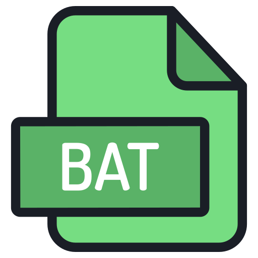

<div align="center">



# BAT to EXE Converter

**Zero-dependency Windows `.bat` to `.exe` compiler & standalone desktop utility suite.**

[](https://github.com/sanchar303/bat-to-exe)
[-22c55e?style=flat-square)](https://github.com/sanchar303/bat-to-exe)
[](https://github.com/sanchar303/bat-to-exe/deployments)
[](https://tr.ee/sanchar)

[Download Converter](./bat_to_exe_converter.exe) · [Quick Start](#quick-start) · [Standalone Tools](#more-standalone-tools) · [More Websites & Apps](#more-websites-apps--projects) · [Repo Layout](#repository-structure)

</div>

---

## Overview

`bat_to_exe_converter.exe` compiles any Windows batch script (`.bat`) into a portable, standalone executable (`.exe`) without third-party wrappers, SDKs, or external runtimes. It leverages the native `.NET` C# compiler and imaging libraries already built into Windows 10 and Windows 11.

This repository also powers the live **GitHub Pages** download portal (`index.html`) and bundles four standalone, single-binary Windows utilities ready to download and run immediately.

---

## Quick Start

1. **Download** [`bat_to_exe_converter.exe`](./bat_to_exe_converter.exe) and place it in any folder on your Windows PC.
2. **Add a custom icon (optional):** Place a PNG named `favicon.png` in the same folder as your `.bat` file or `bat_to_exe_converter.exe`. If no `favicon.png` is present, it compiles cleanly with the standard Windows icon.
3. **Drag and drop:** Drag any `.bat` file directly onto `bat_to_exe_converter.exe`.

A matching `.exe` (for example, `script.bat` → `script.exe`) is generated immediately in the same directory.

---

## How It Works

| Capability | Behavior |
| :--- | :--- |
| **Native Compilation** | Invokes the built-in Windows `.NET` C# toolchain (`csc.exe`)—no Python, Node.js, or external compilers required. |
| **Auto-Matched Output** | Preserves your source filename and writes the compiled `.exe` right next to the original `.bat`. |
| **Multi-Size Icon Embedding** | Automatically converts `favicon.png` into a sharp multi-resolution Windows `.ico` resource when present. |
| **Argument Forwarding** | Dragging files or folders onto your compiled `.exe` forwards all `%*` command-line arguments to your batch script intact. |

---

## More Standalone Tools

Every utility below is pre-compiled, portable, and ready to run on Windows 10 / 11 with zero installation:

| Tool | Binary | Description |
| :--- | :--- | :--- |
| **Live Size Monitor** | [`live_size.exe`](./live_size.exe) | Drag any file or folder onto it to track real-time size, write speed, net delta, and disk I/O activity inside a live console HUD. |
| **Hyper-Extract Studio** | [`archive.exe`](./archive.exe) | Multi-threaded archiving and extraction engine built to pack large directories and extract heavy archives fast. |
| **NetPulse Command** | [`network.exe`](./network.exe) | Real-time network command center to monitor live throughput, reveal saved Wi-Fi keys, generate PNG Wi-Fi QR codes, host custom hotspots, and scan LAN devices. |
| **Piano** | [`piano.exe`](./piano.exe) | Zero-latency 88-key polyphonic studio piano with 6 built-in instrument presets, live chord detection, sustain pedal, and auto-shifting keyboard shortcuts across every octave. |

---

## More Websites, Apps & Projects

Explore the full directory of web apps, browser games, developer utilities, and live experiments built by **Sanchar Koirala**:

<div align="center">

<a href="https://tr.ee/sanchar" target="_blank" rel="noopener noreferrer">
  
</a>

<br />

**[Launch Full Directory → `tr.ee/sanchar`](https://tr.ee/sanchar)** &nbsp;·&nbsp; Direct Link: [`linktr.ee/sanchar`](https://linktr.ee/sanchar)

</div>

---

## Repository Structure

```text
bat-to-exe/
├── bat_to_exe_converter.exe    # Primary drag-and-drop BAT to EXE compiler
├── live_size.exe               # Real-time file/folder size & I/O HUD monitor
├── archive.exe                 # Hyper-Extract Studio multi-threaded archiver
├── network.exe                 # NetPulse Command network & Wi-Fi utility
├── piano.exe                   # 88-key low-latency polyphonic studio piano
├── index.html                  # Single-file web download portal (GitHub Pages)
├── favicon.png                 # Site icon & default .exe icon asset
├── CNAME                       # Custom domain configuration for GitHub Pages
├── google450a35d41fc058df.html # Google Search Console site verification
└── README.md                   # Project documentation
```

---

## Running Unsigned Executables on Windows

Because these binaries are lightweight, self-compiled standalone `.exe` tools without a paid commercial EV certificate, **Windows Defender SmartScreen** may show a *"Windows protected your PC"* prompt on first launch.

To run:
1. Click **More info**.
2. Click **Run anyway**.

---

<div align="center">

 **Built for everyone by [Sanchar Koirala](https://tr.ee/sanchar)**

[GitHub (`@sanchar303`)](https://github.com/sanchar303) &nbsp;·&nbsp; [All Websites & Apps (`tr.ee/sanchar`)](https://tr.ee/sanchar)

</div>
