<div align="center">

<a href="https://github.com/sanchar303/bat-to-exe" title="BAT to EXE Converter">
  
</a>

<br /><br />


# BAT to EXE Converter

**Zero-dependency Windows `.bat` to `.exe` compiler & standalone desktop utility suite.**

[](https://github.com/sanchar303/bat-to-exe)
[-22c55e?style=flat-square)](https://github.com/sanchar303/bat-to-exe)
[](https://github.com/sanchar303/bat-to-exe/deployments)
[](https://tr.ee/sanchar)

[Download Converter](./bat_to_exe_converter.exe) · [Quick Start](#quick-start) · [Standalone Tools](#more-standalone-tools) · [More Websites & Apps](#more-websites-apps--projects) · [Repo Layout](#repository-structure)

</div>

---

## Overview

`bat_to_exe_converter.exe` compiles any Windows batch script (`.bat`) into a portable, standalone executable (`.exe`) without third-party wrappers, SDKs, or external runtimes. It uses the native `.NET` C# compiler and imaging libraries already built into Windows 10 and Windows 11.

This repository also powers the live **GitHub Pages** download portal (`index.html`) and bundles four standalone, single-binary Windows utilities ready to download and run immediately.

---

## Quick Start

1. **Download** [`bat_to_exe_converter.exe`](./bat_to_exe_converter.exe) and place it in any folder on your Windows PC.
2. **Add a custom icon (optional):** Place a PNG named `favicon.png` in the same folder as your `.bat` file or `bat_to_exe_converter.exe`. If no `favicon.png` is present, it compiles cleanly with the standard Windows icon.
3. **Drag and drop:** Drag any `.bat` file directly onto `bat_to_exe_converter.exe`.

A matching `.exe` (for example, `script.bat` → `script.exe`) is generated immediately in the same directory.

---

## How It Works

| Capability | Behavior |
| :--- | :--- |
| **Native Compilation** | Invokes the built-in Windows `.NET` C# toolchain (`csc.exe`)—no Python, Node.js, or external compilers required. |
| **Auto-Matched Output** | Preserves your source filename and writes the compiled `.exe` right next to the original `.bat`. |
| **Multi-Size Icon Embedding** | Automatically converts `favicon.png` into a sharp multi-resolution Windows `.ico` resource when present. |
| **Argument Forwarding** | Dragging files or folders onto your compiled `.exe` forwards all `%*` command-line arguments to your batch script intact. |

---

## More Standalone Tools

Every utility below is pre-compiled, portable, and ready to run on Windows 10 / 11 with zero installation:

| Tool | Binary | Description |
| :--- | :--- | :--- |
| **Live Size Monitor** | [`live_size.exe`](./live_size.exe) | Drag any file or folder onto it to track real-time size, write speed, net delta, and disk I/O activity inside a live console HUD. |
| **Hyper-Extract Studio** | [`archive.exe`](./archive.exe) | Multi-threaded archiving and extraction engine built to pack large directories and extract heavy archives fast. |
| **NetPulse Command** | [`network.exe`](./network.exe) | Real-time network command center to track live throughput, reveal saved Wi-Fi keys, generate PNG Wi-Fi QR codes, host custom hotspots, and scan LAN devices. |
| **Piano** | [`piano.exe`](./piano.exe) | Zero-latency 88-key polyphonic studio piano with 6 built-in instrument presets, live chord detection, sustain pedal, and auto-shifting keyboard shortcuts across every octave. |

---

## More Websites, Apps & Projects

> **Sanchar Koirala ( संचार )** — *"Wubba Lubba Dub Dub"*

Click anywhere on the preview card below to launch **`tr.ee/sanchar`**, or explore and download all of my live web apps, games, utilities, and standalone releases listed below:

<div align="center">

<a href="https://tr.ee/sanchar" title="Open Sanchar Koirala — Official Link Hub (tr.ee/sanchar)">
  
</a>

<br /><br />

<a href="https://tr.ee/sanchar" title="Visit tr.ee/sanchar">
  
</a>

<br />

<sub>Short URL: <a href="https://tr.ee/sanchar"><code>tr.ee/sanchar</code></a> &nbsp;·&nbsp; Direct Linktree: <a href="https://linktr.ee/sanchar"><code>linktr.ee/sanchar</code></a></sub>

</div>

### Direct App & Executable Downloads (`.apk` & `.exe`)

| Release | Platform | Direct Download |
| :--- | :--- | :--- |
| **Download : SK Bank (.apk) - GitHub** | Android APK | [Download `.apk`](https://github.com/sanchar303/data/raw/refs/heads/master/SK%20Bank_v1.0.0_20261109.apk) |
| **Download : Dell G15 Movies (.apk) - GitHub** | Android APK | [Download `.apk`](https://github.com/sanchar303/data/raw/refs/heads/master/Dell%20G15%20Movies_v1.0.0_20261113.apk) |
| **Download : Dell G15 Movies (.exe) - GitHub** | Windows EXE | [Download `.exe`](https://github.com/sanchar303/data/raw/refs/heads/master/dell-g15-movies.pages.dev.exe) |

### Games, Multiplayer & Interactive Web Apps

| Project | Live Link | Platform |
| :--- | :--- | :--- |
| **Play Mine** | [`play-mine.pages.dev`](https://play-mine.pages.dev) | Cloudflare Pages |
| **फलास** | [`falash.pages.dev`](https://falash.pages.dev) | Cloudflare Pages |
| **Only Me Ted** | [`only-me-ted.pages.dev`](https://only-me-ted.pages.dev) | Cloudflare Pages |
| **Cosmic Void** | [Open Cosmic Void](https://share.google/D06rD7kBRYKtDGZKz) | Web App |
| **P2P Games** | [`p2p-ttt.pages.dev`](https://p2p-ttt.pages.dev) | Cloudflare Pages |
| **SK57 P2P (Cloudflare)** | [Open SK57 P2P (Cloudflare)](https://share.google/rBfcygjrgFAc0Lrt0) | Cloudflare |
| **SK57 P2P (Netlify)** | [`sk57-p2p.netlify.app`](https://sk57-p2p.netlify.app) | Netlify |
| **The Mafia Game** | [Open The Mafia Game](https://share.google/kD0yNupyOV0DyMr3x) | Web App |
| **LoveLab - Your Love Connection** | [Open LoveLab](https://share.google/Kvred7kvoM3nWUeTX) | Web App |
| **GiggleBytes \| Instant Humor** | [Open GiggleBytes](https://share.google/HSiAt6n39jhMuZVBg) | Web App |

### AI, Cloud, Security & Developer Tools

| Project | Live Link | Platform |
| :--- | :--- | :--- |
| **Aetheria** | [Open Aetheria](https://share.google/EAjJCYtv9BU0PWZma) | Web App |
| **UNC AI** | [`unc-ai.netlify.app`](https://unc-ai.netlify.app) | Netlify |
| **NVIDIA AI** | [Open NVIDIA AI](https://share.google/JLBJGCMYR8MaL2m1F) | Web App |
| **UNC API** | [Open UNC API](https://share.google/2orpDgwhPEC47e0Yj) | Web App |
| **The Citadel Node** | [Open The Citadel Node](https://share.google/DSRQ4cuFHv2EquYGw) | Web App |
| **The Citadel Node (Netlify)** | [`the-citadel-node.netlify.app`](https://the-citadel-node.netlify.app) | Netlify |
| **Command Prompt** | [Open Command Prompt](https://share.google/YJFO7Ji4twqWp0m52) | Web Terminal |
| **Flash Server Deploy** | [Open Flash Server Deploy](https://share.google/NYTlgTzotC4HLoWvb) | Web App |
| **Sanchar DB** | [Open Sanchar DB](https://share.google/91XLsxqgC3b4eavsU) | Web App |
| **SK Authenticator** | [`sk-auth.pages.dev`](https://sk-auth.pages.dev) | Cloudflare Pages |
| **SK File Transfer Protocol** | [`skftp.pages.dev`](https://skftp.pages.dev) | Cloudflare Pages |
| **SK Control** | [Open SK Control](https://share.google/3nkYhJf5SqS2th3Mt) | Web App |
| **CloudM Nexus** | [`cloudm.pages.dev`](http://cloudm.pages.dev) | Cloudflare Pages |
| **SK Embed** | [`sk-embed.pages.dev`](https://sk-embed.pages.dev) | Cloudflare Pages |
| **PeerSync** | [Open PeerSync](https://share.google/uT3nd2ol5XBlPrTPT) | Web App |
| **RPC 303** | [`rpc303.netlify.app`](https://rpc303.netlify.app) | Netlify |
| **Online IP** | [`online-ip.netlify.app`](https://online-ip.netlify.app) | Netlify |
| **SanLogic \| Digital Simulator** | [Open SanLogic](https://share.google/3DNFEeYmHS0nkE4Tc) | Web App |

### Finance, POS, Economy & Blockchain

| Project | Live Link | Platform |
| :--- | :--- | :--- |
| **NP Miner** | [Open NP Miner](https://share.google/KaQCIS8F8IP6XgZoC) | Web App |
| **Project Economy** | [Open Project Economy](https://share.google/it8q8tYvuyck9krjQ) | Web App |
| **8848 - Cloud Restaurant POS** | [Open 8848 POS](https://share.google/wBzsOLhRs3t7CRuGg) | Web App |
| **Chrono Wealth Vault** | [Open Chrono Wealth Vault](https://share.google/LtVTUu84eP6q6KsmN) | Web App |
| **My BlockChain (Netlify)** | [`b-chain.netlify.app`](https://b-chain.netlify.app) | Netlify |
| **My BlockChain (Cloudflare)** | [`b-chain.pages.dev`](https://b-chain.pages.dev) | Cloudflare Pages |
| **EVT \| Everest Token** | [`evtoken.netlify.app`](https://evtoken.netlify.app) | Netlify |

### Streaming, Media & Social Platforms

| Project | Live Link | Platform |
| :--- | :--- | :--- |
| **Dell G15 Movies** | [Open Dell G15 Movies](https://share.google/7hzZvSfqNjw9m8Dem) | Web App |
| **Romisha** | [`romisha-mp4.pages.dev`](https://romisha-mp4.pages.dev) | Cloudflare Pages |
| **SK IMDB** | [Open SK IMDB](https://share.google/k67MUdCETyYA7nnhV) | Web App |
| **Youtube - Ad Free** | [Open Youtube - Ad Free](https://share.google/9tXtH8uABhLnTVH8p) | Web App |
| **Nexus - Social Hub** | [`nexus-social-hub.netlify.app`](https://nexus-social-hub.netlify.app) | Netlify |
| **Public Chat** | [Open Public Chat](https://share.google/W1iUFMr2xmJnEmRIF) | Web App |
| **Decentralized Chat** | [Open Decentralized Chat](https://share.google/7ZylnFJygPEbZUA90) | Web App |
| **NexChat \| Secure P2P** | [Open NexChat](https://share.google/PbyGS49lPlW8gJjRI) | Web App |
| **Clubhouse SK** | [Open Clubhouse SK](https://share.google/2cATBrYK1ShpkhxCN) | Web App |
| **UNC BOARD** | [Open UNC BOARD](https://share.google/H0PtmXEGnb1nQr9bL) | Web App |
| **My Private Wall** | [Open My Private Wall](https://share.google/5u5pWng1uC2CZi7Dj) | Web App |

### Utilities, Academic, CV & Profile

| Project | Live Link | Platform |
| :--- | :--- | :--- |
| **DupliApp (Cloudflare)** | [`dupliapp.pages.dev`](https://dupliapp.pages.dev) | Cloudflare Pages |
| **DupliApp (Netlify)** | [Open DupliApp (Netlify)](https://share.google/XNlE42IKn9axOPEg6) | Netlify |
| **Eh-Pic Fair** | [Open Eh-Pic Fair](https://share.google/c4m5cYEkUL2GegRq7) | Web App |
| **P1 - Calculator** | [Open P1 - Calculator](https://share.google/cPIR9i2XVG8UT6xUf) | Web App |
| **MAT Questions - Portal** | [`mat-questions.pages.dev`](https://mat-questions.pages.dev) | Cloudflare Pages |
| **Shopping List** | [`sk-list.pages.dev`](https://sk-list.pages.dev) | Cloudflare Pages |
| **Unc Share** | [Open Unc Share](https://share.google/fYmDAhR6ZVVzh7mw7) | Web App |
| **Digital Print** | [Open Digital Print](https://share.google/CfOPbFAes8AYZHcx0) | Web App |
| **Sanchar Koirala CV (Cloudflare)** | [Open CV (Cloudflare)](https://share.google/l8BoEKpKGNkhnSmcp) | Cloudflare |
| **Sanchar Koirala CV (Netlify)** | [Open CV (Netlify)](https://share.google/r0LR7zVfgmy3G2wLn) | Netlify |
| **LinkedIn** | [Open LinkedIn Profile](https://lnkd.in/p/gYCmjJau) | LinkedIn |

### Socials & Direct Contact

<div align="center">

[](https://facebook.com/SancharK)
[](https://instagram.com/sanchar888)
[](https://tiktok.com/@s.koirala888)
[](https://www.youtube.com/channel/UC_JRC1py4SMgcQAF_qWSiiQ)
[](https://api.whatsapp.com/send?phone=9779767916847)
[](mailto:koirala57111+linktreebutton@gmail.com)
[](https://www.snapchat.com/add/s.koirala888)
[](https://x.com/Sanchar888)

</div>

---

## Repository Structure

```text
bat-to-exe/
├── banner.svg                  # Animated repository header banner
├── bat_to_exe_converter.exe    # Primary drag-and-drop BAT to EXE compiler
├── live_size.exe               # Real-time file/folder size & I/O HUD monitor
├── archive.exe                 # Hyper-Extract Studio multi-threaded archiver
├── network.exe                 # NetPulse Command network & Wi-Fi utility
├── piano.exe                   # 88-key low-latency polyphonic studio piano
├── index.html                  # Single-file web download portal (GitHub Pages)
├── favicon.png                 # Site icon & default .exe icon asset
├── linktree-preview.png        # Visual preview card for tr.ee/sanchar
├── CNAME                       # Custom domain configuration for GitHub Pages
├── google450a35d41fc058df.html # Google Search Console site verification
└── README.md                   # Project documentation

---
```
## Running Unsigned Executables on Windows

Because these binaries are lightweight, self-compiled standalone `.exe` tools without a paid commercial EV certificate, **Windows Defender SmartScreen** may show a *"Windows protected your PC"* prompt on first launch.

To run:
1. Click **More info**.
2. Click **Run anyway**.

---

<div align="center">

 **Built for everyone by [Sanchar Koirala ( संचार )](https://tr.ee/sanchar)**

[GitHub (`@sanchar303`)](https://github.com/sanchar303) &nbsp;·&nbsp; [All Websites & Apps (`tr.ee/sanchar`)](https://tr.ee/sanchar)

</div>
